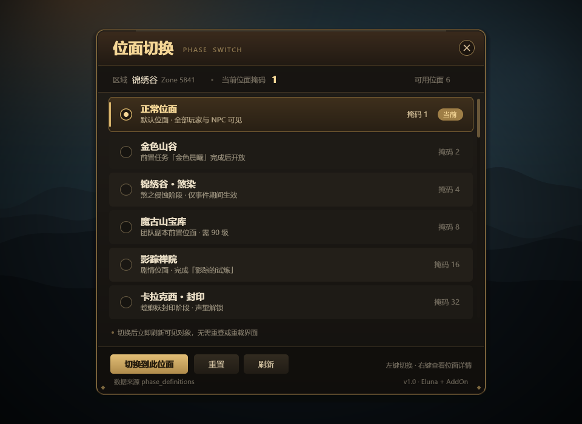

# PhaseSwitch 位面切换插件 — 实现规划

> 项目：Legends of Azeroth · Pandaria 5.4.8（客户端 18414）
> 模块名：`PhaseSwitch`
> 文档版本：v1.2 · 2026-10-19（已按本方案落地；编译与实机验收待执行）
> 状态：已实现（M0–M3 + M4 基础项）

---

## 1. 目标与范围

### 1.1 目标

为玩家提供一个游戏内面板，能够：

1. **获取**当前角色所在区域可用的位面列表（来自 `phase_definitions`）；
2. **显示**当前位面掩码与每个位面的名称、解锁说明、掩码值；
3. **切换**到指定位面，立即生效，无需重登、无需 GM 命令。

### 1.2 非目标

| 不做的事 | 原因 |
|---|---|
| 跨区域传送 | 位面是 **zone 维度** 的概念，跨区切换无意义，交给传送功能 |
| 位面编辑器（增删改 `phase_definitions`） | 运维用 SQL/DB 工具即可，游戏内编辑风险高 |
| 修改客户端 `.MPQ` | 违反"不改客户端"原则，且 5.4.8 客户端无相关 API |
| 队伍批量切换 | 一期不做，列为 M4 可选增强 |

### 1.3 验收标准

- [ ] 玩家输入 `/ph` 打开面板，2 秒内加载出当前区域位面列表
- [ ] 面板正确标出当前位面（金色高亮 +「当前」徽章）
- [ ] 点击「切换到此位面」后，角色视野内的 NPC/物件立即按新位面刷新
- [ ] 切到无权位面时给出明确错误提示，不产生任何状态变更
- [ ] 无位面定义的区域显示空状态提示，不报错
- [ ] 聊天框零输出（所有反馈走面板状态栏）
- [ ] **验收账号必须是非 GM**：GM 账号下 `SetCustomPhase` 不可见（见 2.3），无法验证 T03

---

## 2. 现状调研

### 2.1 已有能力清单

| 能力 | 位置 | 说明 |
|---|---|---|
| 位面核心管理器 | `src/server/game/Maps/PhaseMgr.h` / `.cpp` | 每个 Player 一个实例，`Player::GetPhaseMgr()` |
| 手动覆写接口 | `PhaseMgr.h:154` → `SetCustomPhase(uint32)` | 唯一**持久**的位面覆写入口 |
| GM 命令 | `src/server/scripts/Commands/cs_modify.cpp:1270` | `.modify phase <mask>`，仅 SEC_GAMEMASTER |
| 位面定义表 | `sql/base/world.sql:3011` → `phase_definitions` | 按 zoneId 配置，条件驱动 |
| 区域位面表 | `sql/base/world.sql` → `phase_area` | AreaId ↔ PhaseId 映射 |
| 服务端收 addon 消息 | `ChatHandler.cpp:743-746` | `#ifdef ELUNA` 下转发给 `ScriptMgr::OnPlayerAddonMessage` |
| Eluna 收 addon 消息 | `HookMgr.h:136` → `PLAYER_EVENT_ON_ADDON_MESSAGE = 38` | 回调签名 `(event, player, msg, prefix, type)` |
| Eluna 发 addon 消息 | `PlayerMethods.cpp:1954` → `Player:SendAddonMessage(prefix, msg, receiver)` | 底层 `Player::WhisperAddon`，prefix ≤ 16、msg ≤ 255 |
| Eluna 位面方法 | `LuaFunctions.cpp:144/218` | 仅 `GetPhaseMask` / `SetPhaseMask`；**缺 `SetCustomPhase`** |
| Eluna 位面方法坑 | `PlayerMethods.cpp:1196` | `GetPhaseMaskForSpawn` 是 `@TODO` 空实现（不 push 返回值），**不可用**；`GetPhaseMask` 返回对象当前生效掩码 |
| Eluna 命令注册 | `GlobalMethods.h:15/33` | 只有 `RegisterServerEvent` / `RegisterPlayerEvent`，**没有 `RegisterCommand`** |
| 客户端能力 | 5.4.8 客户端 | **无任何位面相关 Lua API** |

### 2.2 位面数据模型

`phase_definitions` 一行 = 某区域的一条位面规则：

| 字段 | 类型 | 含义 |
|---|---|---|
| `zoneId` | mediumint | 区域 ID（主键之一） |
| `entry` | smallint | 规则序号（主键之一，同区多条按序判定） |
| `phasemask` | bigint | **服务端可见性掩码**，决定玩家能看到哪些对象 |
| `phaseId` | smallint | 客户端相位 ID（地形/天空盒切换） |
| `terrainswapmap` | smallint | 地形替换图 |
| `worldMapArea` | smallint | 世界地图区域覆盖 |
| `flags` | tinyint | 0x01 覆盖已有 / 0x02 终止后续 / 0x04 取反 |
| `comment` | text | 注释 |

判定条件存放在 `conditions` 表，SourceType 为位面定义（`ConditionMgr::GetConditionsForPhaseDefinition`）。

### 2.3 相位计算优先级（关键设计依据）

`PhaseData::GetCurrentPhasemask()`（`PhaseMgr.cpp:233`）：

```cpp
if (player->IsGameMaster())  return PHASEMASK_ANYWHERE;   // GM 看一切
if (_CustomPhasemask)        return _CustomPhasemask;      // ← 我们的入口，最高优先级
return (_PhasemaskThroughDefinitions | _PhasemaskThroughAuras) ?: PHASEMASK_NORMAL;
```

由此得到三条硬性结论：

1. **`SetCustomPhase` 对普通玩家优先级最高**，且 `_CustomPhasemask` 在 `Recalculate()` 中**不会被清零**，过图、任务状态变化都保持有效 —— 正是"切换位面"需要的语义。
2. **GM 是例外**：`IsGameMaster()` 判断位于 `_CustomPhasemask` **之前**（`PhaseMgr.cpp:235-239`），GM 永远返回 `PHASEMASK_ANYWHERE`，`SetCustomPhase` 对 GM **不产生任何可见效果**。因此：面板必须使用非 GM 账号验收；Lua 层在 `SET` 时对 GM 返回 `E_GM`（见 5.6 / 6.4）。
3. **不能用 `SetPhaseMask`**。它只改对象当前掩码，下一次 `PhaseMgr::Update()` / 区域变更就会把玩家算回去，表现为"切了但立刻弹回"。

### 2.4 通信通道约束

| 约束 | 值 | 出处 |
|---|---|---|
| 前缀长度 | ≤ 16 字节 | `ChatHandler.cpp:726` |
| 单条消息 | ≤ 255 字节 | `PlayerMethods.cpp:1961` |
| 前缀注册 | 客户端需 `RegisterAddonMessagePrefix` | 未注册且已注册数 < 64 时服务端会过滤 |
| 全局开关 | `CONFIG_ADDON_CHANNEL` | `ChatHandler.cpp:740`，默认开启 |

> **中文按 3 字节/字计算**，因此分块预算必须按**字节**而非字符，否则长列表会被截断。

### 2.5 可复用的先例

`contrib/lua_scripts/CoordRecorder.lua` + `contrib/addons/CoordRecorder/` 已经跑通完整链路：
客户端 `SendAddonMessage("CR", text, "WHISPER", UnitName("player"))` → 服务端事件 38 → `player:SendAddonMessage("CR", payload, player)` → 客户端 `CHAT_MSG_ADDON`。
PhaseSwitch 直接复用该模式，只换前缀与协议。

---

## 3. 总体架构

```
┌──────────────────────────── 客户端 (5.4.8) ────────────────────────────┐
│  PhaseSwitch 插件                                                      │
│   ├─ UI 层：面板 / 列表 / 按钮 / 状态栏                                 │
│   ├─ 协议层：REQ 组包、RES 解析、分块重组                              │
│   └─ 事件层：CHAT_MSG_ADDON、ADDON_LOADED、PLAYER_ENTERING_WORLD       │
└───────────────────────────────┬───────────────────────────────────────┘
                                │  addon 消息（前缀 "PH"，自发自收 WHISPER）
┌───────────────────────────────┴───────────────────────────────────────┐
│  服务端 worldserver                                                    │
│   ├─ WorldSession::HandleAddonMessagechatOpcode                        │
│   │      └─ ScriptMgr::OnPlayerAddonMessage  (#ifdef ELUNA)            │
│   ├─ Eluna 脚本 phase_switch.lua                                       │
│   │      ├─ 会话状态 / 限流 / 权限校验                                 │
│   │      ├─ 位面清单缓存（按 zoneId）                                  │
│   │      └─ 调用 Player:SetCustomPhase(mask)  ← 需新增绑定             │
│   └─ PhaseMgr::SetCustomPhase → Update → SendPhaseMaskToPlayer         │
│          └─ Player::SetPhaseMask → UpdateObjectVisibility              │
└───────────────────────────────────────────────────────────────────────┘
                                │
                        world 库：phase_definitions / phase_switch_*
```

职责划分：

- **客户端**：只负责显示与输入，不做任何位面计算（客户端也拿不到）；
- **Lua 脚本**：协议解析、权限、缓存、限流，业务全在这里；
- **核心**：只暴露一个 `SetCustomPhase` 绑定，其余复用现有 `PhaseMgr`。

---

## 4. 数据库设计

### 4.1 读：复用 `phase_definitions`

不新增读取逻辑，直接查：

```sql
SELECT entry, phasemask, phaseId, terrainswapmap, worldMapArea, flags, comment
FROM phase_definitions
WHERE zoneId = ?
ORDER BY entry ASC;
```

### 4.2 新表：`phase_switch_entry`（可切换清单）

`phase_definitions` 是"规则"，不适合直接暴露给玩家（含条件、flags 等内部语义）。新增一张"面向玩家的位面目录"：

```sql
CREATE TABLE IF NOT EXISTS `phase_switch_entry` (
  `zoneId`      mediumint(8) unsigned NOT NULL,
  `mask`        int(10) unsigned     NOT NULL,
  `name`        varchar(32)          NOT NULL DEFAULT '',
  `description` varchar(96)          NOT NULL DEFAULT '',
  `sortOrder`   smallint(5) unsigned NOT NULL DEFAULT '0',
  `enabled`     tinyint(1) unsigned  NOT NULL DEFAULT '1',
  `minLevel`    tinyint(3) unsigned  NOT NULL DEFAULT '0',
  PRIMARY KEY (`zoneId`,`mask`),
  KEY `idx_zone_enabled` (`zoneId`,`enabled`,`sortOrder`)
) ENGINE=InnoDB DEFAULT CHARSET=utf8mb4;
```

- `name` / `description` 禁用 `|`、`;`、`:`（协议分隔符），加载时做校验并记日志；
- `minLevel` 为 0 表示不限；
- 协议中的 `zoneName` 来自服务端区域数据（DBC），**不经过本表**，下发前同样必须过滤 `|`、`;`、`:`；
- `varchar` 长度按**字符**计，中文按 3 字节/字。下发协议时按字节截断（`name` 48B / `description` 120B），否则单条可能超过 255 字节。

### 4.3 新表：`phase_switch_permission`（白名单，M3 启用）

```sql
CREATE TABLE IF NOT EXISTS `phase_switch_permission` (
  `accountId` int(10) unsigned NOT NULL,
  `zoneId`    mediumint(8) unsigned NOT NULL DEFAULT '0',  -- 0 = 全区域
  `mask`      int(10) unsigned NOT NULL DEFAULT '0',      -- 0 = 全部位面
  PRIMARY KEY (`accountId`,`zoneId`,`mask`)
) ENGINE=InnoDB DEFAULT CHARSET=utf8mb4;
```

> **库归属（编码前必须确定）**：该表以 `accountId` 为主键，语义上属于 **auth 库**，脚本应使用 `AuthDBQuery` 读取；若坚持放 world 库，则改用 `WorldDBQuery`，但需自行保证与 auth 库账号数据同步。建表脚本必须写明目标库。
>
> `accountId` 在 Eluna 中通过 `player:GetAccountId()` 获取（`LuaFunctions.cpp:348`）。

### 4.4 示例数据（锦绣谷 5841）

```sql
INSERT INTO phase_switch_entry (zoneId, mask, name, description, sortOrder) VALUES
(5841,  1, '正常位面',        '默认位面 · 全部玩家与 NPC 可见', 0),
(5841,  2, '金色山谷',        '前置任务「金色晨曦」完成后开放', 1),
(5841,  4, '锦绣谷 · 煞染',   '煞之侵蚀阶段 · 仅事件期间生效',   2),
(5841,  8, '魔古山宝库',      '团队副本前置位面 · 需 90 级',     3),
(5841, 16, '影踪禅院',        '剧情位面 · 完成「影踪的试炼」',   4),
(5841, 32, '卡拉克西 · 封印', '螳螂妖封印阶段 · 声望解锁',      5);
```

### 4.5 缓存策略

- 脚本启动时全量载入 `phase_switch_entry` 到 Lua 表 `entriesByZone`；
- 首次访问某 zone 时再载入其 `phase_definitions`（用于校验 mask 是否真实存在）；
- 缓存重载入口：**`#phreload`**（已实现，监听 `PLAYER_EVENT_ON_CHAT` 事件 18）。
  - **不能使用 `.phreload`**：以 `.` / `!` 开头的未知命令会先被核心 `ChatHandler::ParseCommands` 拦截（`Chat.cpp:459-465`），根本到不了 Eluna 的 `OnChat`。
  - `#phreload` 不触发命令解析；GM 输入后脚本返回 `false` 消费该消息并清空缓存。
  - 备选：在 `cs_` 命令表中新增 C++ 命令（需重编译）。

---

## 5. 通信协议

### 5.1 通道参数

| 项 | 值 |
|---|---|
| 前缀 | `PH` |
| 发送方式 | 客户端 `SendAddonMessage("PH", payload, "WHISPER", UnitName("player"))` |
| 回发方式 | 服务端 `player:SendAddonMessage("PH", payload, player)` |
| 单条上限 | 255 字节（含分隔符），实际预算 **≤ 200 字节** |
| 字符集 | UTF-8 |

### 5.2 报文格式

请求（客户端 → 服务端）：

```
REQ|<seq>|<CMD>|<arg1>|<arg2>
```

响应（服务端 → 客户端）：

```
RES|<seq>|<OK|ERR>|<code>|<payload>
```

- `seq`：客户端自增序号，服务端原样回传，用于丢弃过期响应；
- `code`：`OK` 时为数据类型（如 `LIST`、`CUR`），`ERR` 时为错误码。

### 5.3 指令表

| CMD | 参数 | 说明 | 返回 code |
|---|---|---|---|
| `PING` | — | 握手，验证通道可用 | `PONG` |
| `LIST` | — | 取当前区域可切换位面 | `LIST`（可能多块） |
| `GET` | — | 取当前位面掩码与名称 | `CUR` |
| `SET` | `<mask>` | 切换到指定位面 | `SWITCHED` |
| `RESET` | — | 恢复自动计算（mask = 0） | `SWITCHED` |

### 5.4 响应类型

**LIST（分块）**

```
RES|<seq>|OK|LIST|<chunkIdx>|<chunkTotal>|<zoneId>|<zoneName>|<items>
items := "<mask>:<name>:<desc>;<mask>:<name>:<desc>;..."
```

示例（第 1/2 块）：

```
RES|7|OK|LIST|1|2|5841|锦绣谷|1:正常位面:默认位面 · 全部玩家可见;2:金色山谷:前置任务完成后开放
```

**CUR**

```
RES|<seq>|OK|CUR|<mask>|<name>|<zoneId>
```

> `mask` 必须是**当前实际生效的掩码**（服务端取 `player:GetPhaseMask()`），而不是 `_CustomPhasemask`。自动计算模式下二者不同：`_CustomPhasemask == 0` 时玩家仍可能因 `phase_definitions` 生效于非 0 掩码。面板高亮据此判断。

**SWITCHED**

```
RES|<seq>|OK|SWITCHED|<mask>|<name>
```

**PONG**

```
RES|<seq>|OK|PONG|<serverVersion>
```

### 5.5 分块规则

```lua
local BUDGET = 200                 -- 单条 payload 字节上限（留 55 字节给头部）
local items, cur, curLen = {}, {}, 0
for _, e in ipairs(list) do
    local s = e.mask .. ":" .. e.name .. ":" .. e.desc
    local add = #s + (#cur > 0 and 1 or 0)
    if #cur > 0 and curLen + add > BUDGET then
        items[#items + 1] = table.concat(cur, ";")
        cur, curLen = {}, 0
    end
    cur[#cur + 1] = s
    curLen = curLen + #s + (#cur > 1 and 1 or 0)
end
if #cur > 0 then items[#items + 1] = table.concat(cur, ";") end
```

> `#s` 在 Lua 中返回**字节数**，正好满足 UTF-8 预算需求。

### 5.6 错误码

| code | 含义 | 客户端表现 |
|---|---|---|
| `E_ZONE` | 当前区域无位面配置 | 空状态："该区域没有可切换的位面" |
| `E_MASK` | mask 不在可切换清单 | 红字："该位面不可用" |
| `E_PERM` | 无权限 | 红字："你没有切换到该位面的权限" |
| `E_LEVEL` | 等级不足，payload 携带所需等级 `N` | 红字："需要等级 N" |
| `E_COOLDOWN` | 冷却中，payload 携带剩余秒数 `N` | 红字："请 N 秒后再试" |
| `E_BUSY` | 战斗/载入中 | 红字："战斗中无法切换位面" |
| `E_ARGS` | 参数非法 | 红字："参数错误" |
| `E_GM` | GM 账号不支持自定义位面 | 红字："GM 模式已可见全部位面，无需切换" |
| `E_BIND` | 核心缺少 `SetCustomPhase` 绑定 | 红字："服务端未启用位面切换（缺少核心绑定）" |

> 带参数的错误码格式为 `RES|<seq>|ERR|<code>|<N>`；无参数时 payload 为空（保留尾部 `|`）。客户端 `ERR_TEXT[code]` 为格式化字符串，需替换 `%d`。

### 5.7 交互时序

```
客户端                                     服务端
  │ ADDON_LOADED → RegisterAddonMessagePrefix("PH")
  │ /ph → 面板显示
  │── REQ|1|PING ─────────────────────────►│
  │◄─ RES|1|OK|PONG|1.0 ───────────────────│  握手成功，状态栏"已连接"
  │── REQ|2|LIST ─────────────────────────►│  查缓存/DB
  │◄─ RES|2|OK|LIST|1|2|5841|锦绣谷|... ───│
  │◄─ RES|2|OK|LIST|2|2|5841|锦绣谷|... ───│  重组后渲染列表
  │── REQ|3|GET ──────────────────────────►│
  │◄─ RES|3|OK|CUR|1|正常位面|5841 ────────│  高亮当前行
  │   点击「切换到此位面」(mask=4)
  │── REQ|4|SET|4 ────────────────────────►│  校验权限/等级/冷却
  │                                        │  SetCustomPhase(4)
  │                                        │  Update → 刷新可见性
  │◄─ RES|4|OK|SWITCHED|4|锦绣谷 · 煞染 ───│  更新 UI，状态栏提示
```

---

## 6. 服务端实现

### 6.1 核心改动：新增 Eluna 绑定（约 10 行）

Eluna 当前只导出了 `GetPhaseMask` / `SetPhaseMask`，缺 `SetCustomPhase`。

**`src/server/game/LuaEngine/PlayerMethods.h`**（在 `GetPhaseMaskForSpawn` 附近声明）

```cpp
int SetCustomPhase(lua_State* L, Player* player);
```

**`src/server/game/LuaEngine/PlayerMethods.cpp`**

```cpp
int SetCustomPhase(lua_State* L, Player* player)
{
    uint32 phaseMask = static_cast<uint32>(luaL_checknumber(L, 1));
    player->GetPhaseMgr().SetCustomPhase(phaseMask);
    return 0;
}
```

**`src/server/game/LuaEngine/LuaFunctions.cpp`**（Player 方法表，按字母序插入）

```cpp
{"SetCustomPhase", &LuaPlayer::SetCustomPhase},  // :SetCustomPhase(mask) - 覆写位面掩码，0 恢复自动计算
```

> `PhaseMgr::SetCustomPhase` 内部已置 `PHASE_UPDATE_FLAG_SERVERSIDE_CHANGED` 并调用 `Update()`，最终走 `SendPhaseMaskToPlayer()` → `Player::SetPhaseMask` → `UpdateObjectVisibility()`，**无需额外刷新代码**。
>
> **GM 例外**：`GetCurrentPhasemask()` 中最先短路 `IsGameMaster()`，GM 调用 `SetCustomPhase` 不会有可见效果。绑定本身不做拦截，由 Lua 层在 `CmdSet` 中返回 `E_GM`（见 6.4）。

### 6.2 备选方案：C++ Module（不改 Lua）

`ScriptMgr::OnPlayerAddonMessage` 是 PlayerScript 钩子，模块可直接继承。

**但有一个前提**：`ChatHandler.cpp:743` 的转发调用被包在 `#ifdef ELUNA` 内。若以 `-DELUNA=0` 编译，addon 消息根本到不了 ScriptMgr。

| 方案 | 改动量 | 优点 | 缺点 |
|---|---|---|---|
| **A. Eluna 绑定（推荐）** | 核心 10 行 + Lua 脚本 | 迭代快、可热改、与 CoordRecorder 一致 | 依赖 ELUNA=1（默认开启） |
| B. C++ Module | 新增 module + 可能需移出 `#ifdef ELUNA` | 不依赖 Lua | 每次改逻辑要重编译；与 playerbots 共存更稳 |

**结论：采用方案 A。** 若将来要关闭 Eluna，再迁移到 B。

> **前置条件（阻塞项）**：方案 A 要求目标环境 `ELUNA=1` **且不启用 `mod_playerbots`**。AGENTS.md 明确建议开启 Eluna 时禁用 playerbots，而本项目存在 `bots` 分支。**M0 开工前必须先确认运行环境**；若必须同时启用 playerbots，则方案 A 不可行，改用方案 B 并重新排期。

### 6.3 Lua 脚本结构

文件：`contrib/lua_scripts/phase_switch.lua`

```lua
local PREFIX   = "PH"
local VERSION  = "1.0"
local COOLDOWN = 3          -- 秒

-- 会话：guid -> { lastSwitch = os.time(), reqTimes = {} }
local sessions = {}
-- 缓存：zoneId -> { {mask=, name=, desc=}, ... }
local cache = {}
-- 权限缓存：accountId -> { zoneId -> { mask -> true } }
local perms = {}

local function Reply(player, seq, code, payload)  ... end
local function SendList(player, seq, zoneId)      ... end
local function CmdList(player, seq)               ... end
local function CmdGet(player, seq)                ... end
local function CmdSet(player, seq, maskStr)       ... end
local function CmdReset(player, seq)              ... end

local function OnAddonMessage(event, player, msg, prefix, type)
    if prefix ~= PREFIX then return end
    -- 注意：Lua 模式中 | 是普通字符；|? 允许无参数命令（PING/LIST/GET/RESET）
    local seq, cmd, a1 = msg:match("^REQ|(%d+)|([A-Z]+)|?(.*)$")
    if not cmd then return end
    if     cmd == "PING"  then Reply(player, seq, "OK", "PONG|" .. VERSION)
    elseif cmd == "LIST"  then CmdList(player, seq)
    elseif cmd == "GET"   then CmdGet(player, seq)
    elseif cmd == "SET"   then CmdSet(player, seq, a1)
    elseif cmd == "RESET" then CmdReset(player, seq)
    end
end

RegisterPlayerEvent(38, OnAddonMessage)
```

### 6.4 切换逻辑要点

```lua
local function CmdSet(player, seq, maskStr)
    local mask = tonumber(maskStr)
    if not mask then return Reply(player, seq, "ERR", "E_ARGS") end

    -- 0) GM 例外：GM 始终可见全部位面，自定义掩码无效
    if player:IsGM() then return Reply(player, seq, "ERR", "E_GM") end

    -- 1) 战斗/载入中禁止
    if player:IsInCombat() then return Reply(player, seq, "ERR", "E_BUSY") end

    -- 2) 冷却（payload 携带剩余秒数）
    local s = GetSession(player)
    local remain = COOLDOWN - (os.time() - s.lastSwitch)
    if remain > 0 then
        return Reply(player, seq, "ERR", "E_COOLDOWN|" .. remain)
    end

    -- 3) 清单校验（防止越权切到任意 mask）
    local entry = FindEntry(player:GetZoneId(), mask)
    if not entry then return Reply(player, seq, "ERR", "E_MASK") end

    -- 4) 权限 / 等级（payload 携带所需等级）
    if entry.minLevel > 0 and player:GetLevel() < entry.minLevel then
        return Reply(player, seq, "ERR", "E_LEVEL|" .. entry.minLevel)
    end
    if not CheckPermission(player, entry) then
        return Reply(player, seq, "ERR", "E_PERM")
    end

    -- 5) 执行
    player:SetCustomPhase(mask)
    s.lastSwitch = os.time()
    Reply(player, seq, "OK", "SWITCHED|" .. mask .. "|" .. entry.name)
end
```

### 6.5 安全与限流

| 措施 | 说明 |
|---|---|
| 白名单校验 | `mask` 必须命中 `phase_switch_entry`，杜绝任意 mask 注入 |
| 频率限制 | 每玩家 3 秒冷却；另加**仅 SET/RESET** 每分钟 20 次硬上限（LIST/GET/PING 不受限，避免正常开面板被误伤） |
| 战斗限制 | `IsInCombat()` 直接拒绝 |
| 长度限制 | 请求 payload > 64 字节直接丢弃 |
| 日志 | 每次切换写 `TC_LOG_INFO("scripts", ...)`，便于审计 |
| 权限模式 | 见第 8 节 |

---

## 7. 客户端实现

### 7.1 文件结构

```
contrib/addons/PhaseSwitch/
├── PhaseSwitch.toc
├── PhaseSwitch.lua          -- 入口 / 事件 / 协议
├── UI.lua                   -- 面板构建与刷新
└── design/                  -- 开发辅助，不打包
    ├── mockup.mjs           -- 效果图生成入口
    ├── canvas.mjs
    ├── png.mjs
    └── ttf.mjs

phase_switch_ui.png          -- 界面效果图（仓库根目录，7.2 引用）
```

`PhaseSwitch.toc`：

```
## Interface: 50400
## Title: |cffd6b26a位面切换|r
## Notes: 查看并切换当前区域的位面
## Author: Legends of Azeroth
## Version: 1.0
PhaseSwitch.lua
UI.lua
```

### 7.2 面板布局



| 区域 | 高度 | 内容 |
|---|---|---|
| 标题栏 | 58 | 标题、版本、关闭按钮 |
| 信息条 | 44 | 区域名 / Zone ID / 当前掩码 / 可用数量 |
| 列表 | 6×62 | 每行：图标、名称、说明、掩码、「当前」徽章 |
| 提示行 | 26 | 操作说明 |
| 按钮区 | 48 | 切换（主）/ 重置 / 刷新 |
| 页脚 | 22 | 数据来源、版本 |

尺寸：默认 430×520，可拖动，`SetClampedToScreen(true)`。

### 7.3 事件流

```lua
ADDON_LOADED(addonName == "PhaseSwitch")
  └─ 建面板（默认隐藏）→ RegisterAddonMessagePrefix("PH") → 注册斜杠命令 /ph

PLAYER_ENTERING_WORLD
  └─ 若面板可见 → 发 LIST + GET（区域可能变了）
       · 两条请求各自分配独立 seq，登记到 pending 表
       · 允许同时存在多个未完成请求，响应按 seq 匹配（见 7.4）

CHAT_MSG_ADDON(prefix, msg, channel, sender)
  └─ prefix == "PH" → ParseResponse(msg)
```

### 7.4 响应解析

```lua
-- 未完成请求：seq -> { cmd = "LIST"|"CUR"|"SWITCHED"|"PONG", chunks = {}, total = nil }
-- 用表而不是单一 currentSeq：LIST 与 GET 可能同时在途，且 LIST 分多块共用一个 seq
local pending = {}
local nextSeq = 0

local function SendReq(cmd, arg)
    nextSeq = nextSeq + 1
    local seq = nextSeq
    pending[seq] = { cmd = cmd }
    local msg = "REQ|" .. seq .. "|" .. cmd .. (arg and ("|" .. arg) or "")
    SendAddonMessage(PREFIX, msg, "WHISPER", UnitName("player"))
    return seq
end

local function ParseResponse(msg)
    local seq, status, code, payload = msg:match("^RES|(%d+)|(%a+)|([%w_]+)|(.*)$")
    if not seq then return end
    local req = pending[seq]
    if not req then return end                     -- 未知/过期响应，丢弃

    if status == "ERR" then
        pending[seq] = nil
        -- payload 携带参数（如 E_LEVEL 的所需等级、E_COOLDOWN 的剩余秒数）
        SetStatus(FormatErr(code, payload), true)
        return
    end

    if code == "LIST" then
        -- 分块响应共用同一 seq，收齐 chunkTotal 块后才消费该 seq
        if OnListChunk(payload, req) then pending[seq] = nil end
    else
        pending[seq] = nil
        if     code == "CUR"      then OnCurrent(payload)
        elseif code == "SWITCHED" then OnSwitched(payload)
        elseif code == "PONG"     then SetStatus("已连接服务端", false)
        end
    end
end
```

分块重组（每个请求独立缓冲，避免并发 LIST 互相覆盖）：

```lua
local function OnListChunk(payload, req)
    local idx, total, zoneId, zoneName, items = payload:match("^(%d+)|(%d+)|(%d+)|([^|]*)|(.*)$")
    idx, total = tonumber(idx), tonumber(total)
    if idx == 1 then req.chunks, req.total = {}, total end
    req.chunks[idx] = items
    if idx == req.total then
        RenderList(zoneId, zoneName, table.concat(req.chunks))
        return true                                -- 收齐，允许调用方释放 seq
    end
    return false
end
```

### 7.5 已知客户端坑（来自 CoordRecorder 实践）

| 坑 | 现象 | 对策 |
|---|---|---|
| `OnDragStop` 丢失 | 窗口外松键，窗口粘在光标上 | 只用 `OnDragStart` 记偏移，`OnUpdate` 检测 `IsMouseButtonDown` |
| 登录期渲染 | 进游戏瞬间报错/闪烁 | 面板 `CreateFrame` 后立即 `Hide()` |
| 前缀注册 | 未注册则收不到回包 | `ADDON_LOADED` 里注册并检查返回值 |
| 长列表截断 | 超过 255 字节被服务端丢弃 | 服务端按字节分块（5.5 节） |
| ESC 关闭 | 默认无效 | `tinsert(UISpecialFrames, "PhaseSwitchFrame")` |
| 聊天框污染 | 提示刷屏 | 所有反馈写面板状态栏 |

---

## 8. 权限策略

配置项（写在 `phase_switch.lua` 顶部，或读 `worldserver.conf`）：

```lua
local MODE = 1
-- 0 = 仅 GM（SEC_GAMEMASTER 及以上）
-- 1 = GM + 白名单账号（phase_switch_permission）
-- 2 = 全开放（仅受清单/等级限制）
```

判定顺序：`GM 直接放行` → `MODE==2 放行` → `查白名单` → 拒绝。

**默认 MODE = 1**：先让 GM 和测试账号验证，稳定后再逐步放开。

---

## 9. 测试计划

### 9.1 功能用例

| # | 场景 | 步骤 | 预期 |
|---|---|---|---|
| T01 | 正常打开 | `/ph` | 面板显示，2 秒内出现 6 条位面 |
| T02 | 当前位面高亮 | 观察首行 | 金色边框 +「当前」徽章 |
| T03 | 切换成功 | **非 GM 账号**点「切换到此位面」 | 视野内 NPC 立即按新位面刷新，状态栏提示成功 |
| T04 | 切换失败-无权限 | 非白名单账号点切换 | 红字「没有权限」，位面不变 |
| T05 | 冷却 | 连续点两次 | 第二次提示「请 N 秒后再试」 |
| T06 | 战斗中切换 | 进战斗后点切换 | 提示「战斗中无法切换位面」 |
| T07 | 空区域 | 飞到无配置区域开面板 | 显示空状态，不报错 |
| T08 | 重置 | 点「重置」 | 掩码回 1，视野恢复默认 |
| T09 | 过图保持 | 切换后跨 zone 再回来 | 自定义位面仍生效（`_CustomPhasemask` 不清除） |
| T10 | 断线重连 | 切换后重登 | 自定义位面是否保持（**预期：不保持**，需明确产品决策） |
| T11 | 长列表 | 临时插入 20 条 | 分块重组完整，无截断 |
| T12 | 重载 | `.reload eluna` | 脚本重载后功能正常，缓存重建 |
| T13 | GM 账号 | GM 账号点切换 | 红字「GM 模式已可见全部位面，无需切换」，掩码不变 |
| T14 | 并发请求 | 面板打开瞬间连续触发 LIST + GET | 两条响应都能正确处理，LIST 分块不串块、GET 不被丢弃 |

### 9.2 兼容性

- **前置阻塞项**：方案 A 依赖 `ELUNA=1`。AGENTS.md 明确建议开启 Eluna 时禁用 `mod_playerbots`，而本项目存在 `bots` 分支。**M0 开工前必须先确认目标运行环境是否启用 playerbots**；若必须同时启用，则改用方案 B（C++ Module）并重新排期；
- 中文/英文客户端：面板文本为服务端下发，客户端仅做显示，字体依赖客户端本地化，无需特殊处理。

### 9.3 回归风险

- 修改 `LuaFunctions.cpp` 方法表可能影响 Eluna 其他绑定 → 只**新增**条目，不改动既有；
- `SetCustomPhase` 与 GM 命令共用同一字段，GM 用 `.modify phase` 后玩家再点切换会覆盖 → 可接受，文档说明即可。

---

## 10. 里程碑

> **M0 前置条件（阻塞）**：确认运行环境为 `ELUNA=1` 且 `PLAYERBOTS=0`。若不满足，改用 6.2 方案 B，本表排期需重估。

| 阶段 | 内容 | 交付物 | 预估 |
|---|---|---|---|
| **M0** | 核心绑定 `SetCustomPhase` | 3 个文件的小改动，编译通过 | 0.5 天 |
| **M1** | 最小闭环：`PING/LIST/GET/SET` | 脚本可切位面（无 UI，用聊天触发） | 1 天 |
| **M2** | 客户端面板 | 可拖动面板、列表、按钮、状态栏 | 1.5 天 |
| **M3** | 权限/白名单/冷却/错误码 | 权限表 + 完整错误处理 | 1 天 |
| **M4** | 打磨 | 空状态、滚动条、分块、文档、测试报告 | 1 天 |

合计约 **5 个工作日**（不含评审与回归）。

---

## 11. 风险与对策

| 风险 | 影响 | 概率 | 对策 |
|---|---|---|---|
| 切走后任务 NPC 消失，玩家卡任务 | 中 | 高 | 面板顶部固定提示"切换位面可能隐藏任务 NPC"；提供一键「重置」 |
| 队伍成员看到不同世界 | 中 | 中 | 文档说明；M4 可选"队伍同步"开关 |
| `phase_definitions` 条件与手动 mask 冲突 | 中 | 中 | 手动 mask 对普通玩家优先级最高（GM 例外），行为可预期；在文档中明确 |
| 玩家滥用切到未完成内容 | 高 | 中 | 默认 MODE=1 白名单；清单需人工配置 |
| Eluna 与 playerbots 冲突 | 高 | 中 | **M0 前确认环境**；二选一，或改走方案 B |
| GM 账号测试假成功 | 高 | 高 | 对 GM 返回 `E_GM`；验收强制使用非 GM 账号 |
| 客户端未注册前缀导致无响应 | 低 | 中 | 面板状态栏显示"未连接"，提示重载界面 |
| 中文超出 255 字节被截断 | 低 | 中 | 字节级分块 + T11 用例覆盖 |

---

## 12. 附录

### A. 文件清单（计划新增/修改）

| 类型 | 路径 | 说明 |
|---|---|---|
| 改 | `src/server/game/LuaEngine/PlayerMethods.h` | +1 行声明 |
| 改 | `src/server/game/LuaEngine/PlayerMethods.cpp` | +6 行实现 |
| 改 | `src/server/game/LuaEngine/LuaFunctions.cpp` | +1 行注册 |
| 新 | `contrib/lua_scripts/phase_switch.lua` | 服务端脚本 |
| 新 | `contrib/addons/PhaseSwitch/PhaseSwitch.toc` | 插件清单 |
| 新 | `contrib/addons/PhaseSwitch/PhaseSwitch.lua` | 协议/事件 |
| 新 | `contrib/addons/PhaseSwitch/UI.lua` | 界面 |
| 新 | `sql/updates/world/2026_10_19_00_world_phase_switch.sql` | `phase_switch_entry` 建表 + 示例数据 |
| 新 | `sql/updates/master/auth/2026_10_19_00_auth_phase_switch_permission.sql` | `phase_switch_permission` 白名单表 |
| 已有 | `phase_switch_ui.png` | 界面效果图（仓库根目录） |
| 已有 | `contrib/addons/PhaseSwitch/design/{mockup,canvas,png,ttf}.mjs` | 效果图生成脚本（开发辅助，不打包） |

### B. 关键代码位置索引

| 用途 | 位置 |
|---|---|
| 位面优先级计算 | `src/server/game/Maps/PhaseMgr.cpp:233` |
| 手动覆写入口 | `src/server/game/Maps/PhaseMgr.cpp:221` |
| 掩码下发 | `src/server/game/Maps/PhaseMgr.cpp:250` |
| GM 命令参考实现 | `src/server/scripts/Commands/cs_modify.cpp:1258-1276` |
| addon 消息转发 | `src/server/game/Handlers/ChatHandler.cpp:743-746` |
| Eluna 事件定义 | `src/server/game/LuaEngine/HookMgr.h:136` |
| Eluna 发送实现 | `src/server/game/LuaEngine/PlayerMethods.cpp:1954` |
| 客户端收发范例 | `contrib/addons/CoordRecorder/CoordRecorder.lua` |

### C. 术语表

| 术语 | 含义 |
|---|---|
| 位面 / Phase | 同一地理区域内互相不可见的多套世界状态 |
| phasemask | 服务端可见性位掩码，决定玩家能看到哪些对象 |
| phaseId | 客户端相位编号，控制地形/天空盒 |
| 自定义位面 | 通过 `SetCustomPhase` 强制指定的掩码，对普通玩家优先级最高（GM 不受影响） |
| 定义位面 | 由 `phase_definitions` + 条件自动计算的掩码 |

### D. 待定事项（编码前需确认）

1. **重登后是否保持**：`_CustomPhasemask` 不持久化，重登回默认。是否要做持久化（新增 `character_phase` 表）？
2. **默认权限模式**：建议 MODE=1，需运营确认。注意 MODE=0/1 中的 GM 无法用于验收（见 2.3），需另备非 GM 测试账号。
3. **是否需要队伍同步**：影响 M4 排期。
4. **位面命名权**：`phase_switch_entry.name` 由谁维护（策划/运维）。
5. **权限表库归属**：`phase_switch_permission` 放 auth 库（推荐，配 `AuthDBQuery`）还是 world 库？
6. **运行环境**：目标环境是否启用 playerbots？这决定采用方案 A（Eluna）还是方案 B（C++ Module），必须在 M0 前确认。
